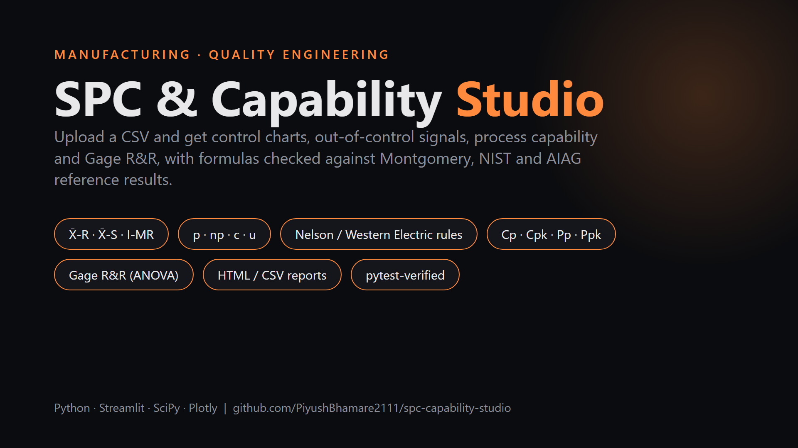
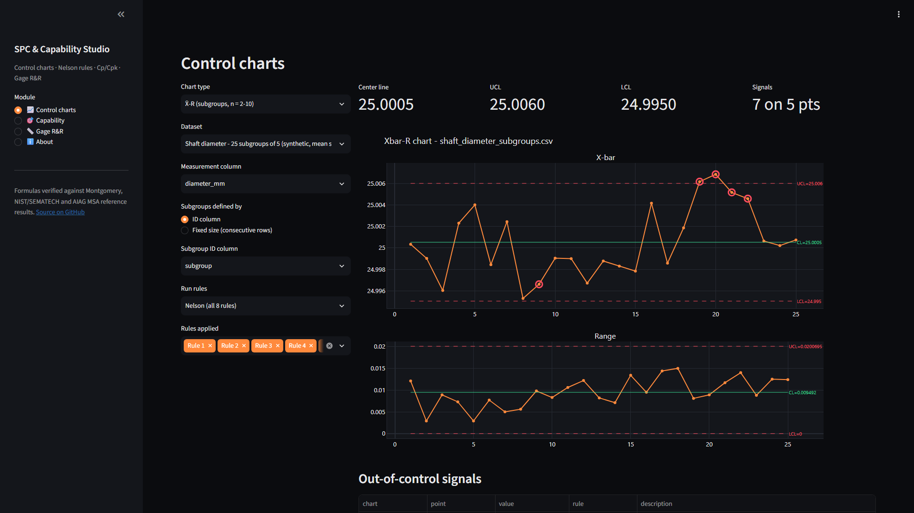
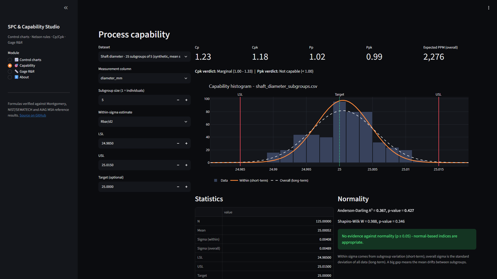
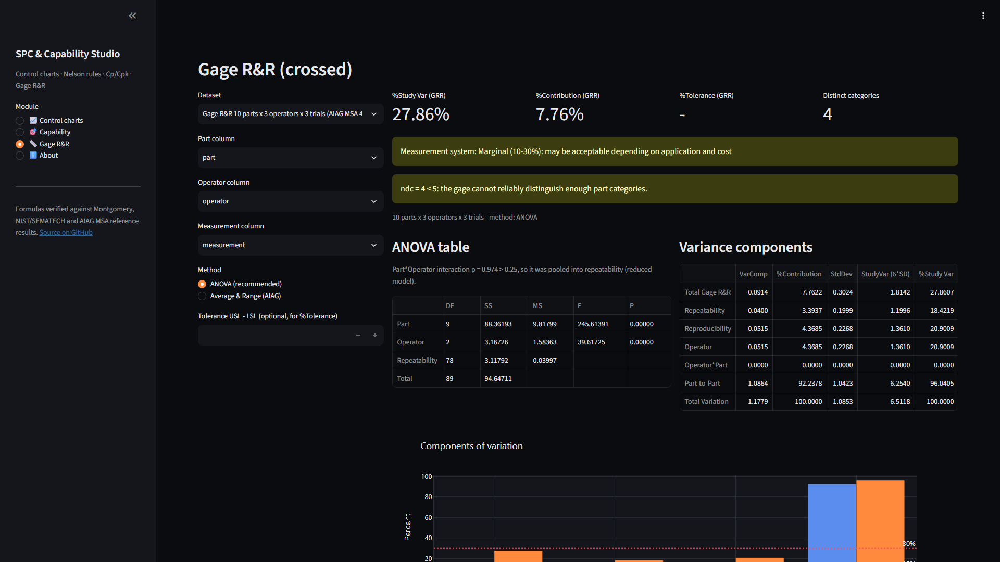
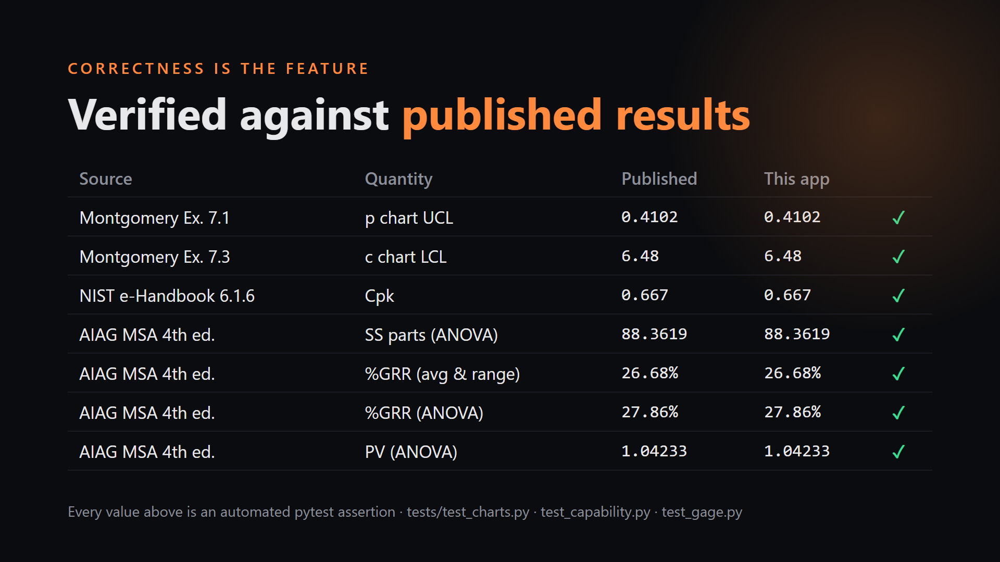
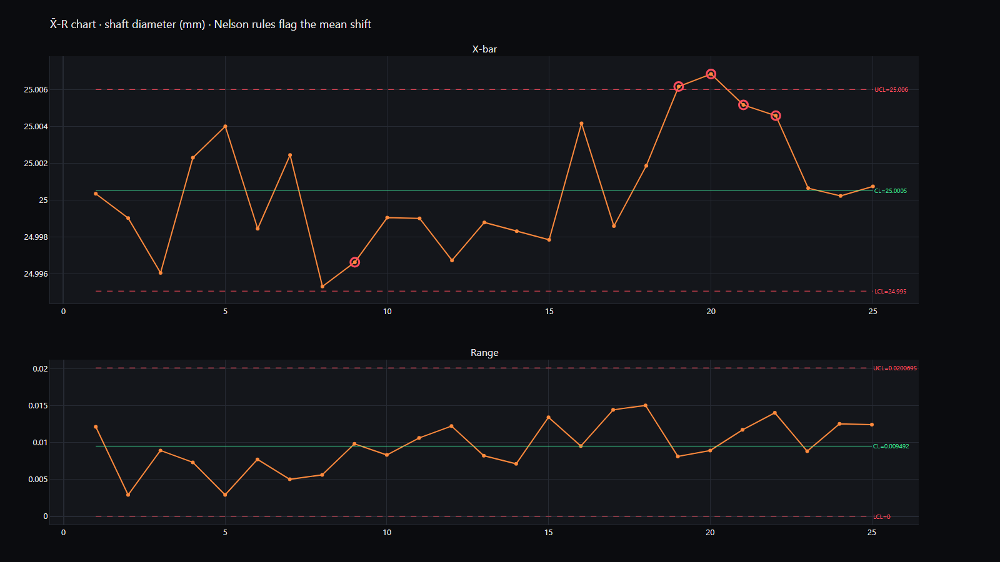
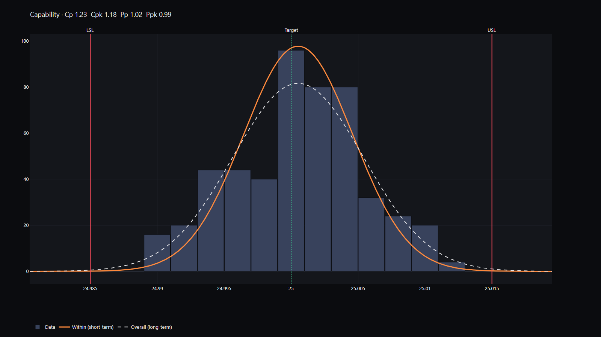
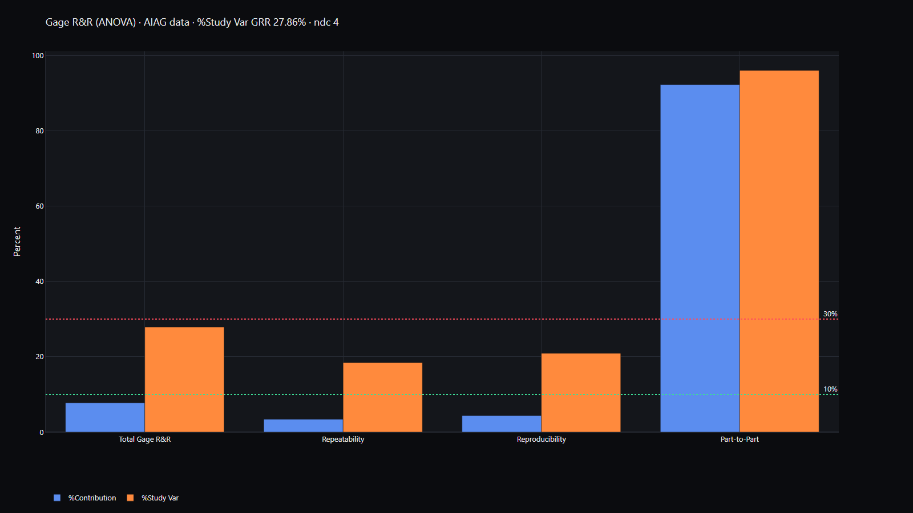
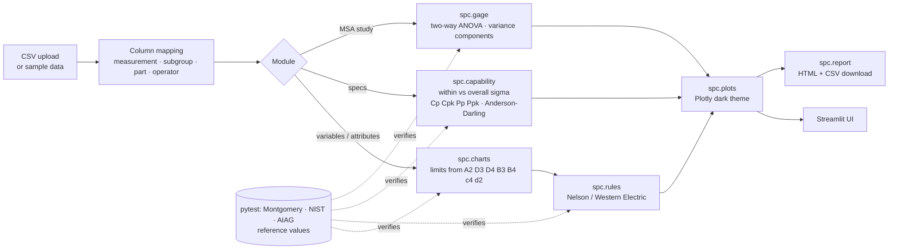

<div align="center">

# SPC & Capability Studio

**Upload a CSV and get control charts, out-of-control signals, Cp/Cpk and Gage R&R in seconds. Every formula is checked against published textbook and AIAG results.**

[](https://www.python.org/)
[](https://streamlit.io/)
[](tests/)
[](#verified-against-published-results)
[](LICENSE)



</div>

---

## Why this exists

On a production floor, SPC is how you tell a process that is **drifting** apart from one that is just **noisy**, and an MSA tells you whether to trust the gauge in the first place. I did this work every week as a manufacturing engineer (SPC, Gage R&R, Cp/Cpk and CAPA in Minitab). This project rebuilds that toolkit as an open, tested Python app. The statistics sit in a small library with no UI code (`spc/`), and a test suite checks the results against numbers printed in the reference books.

## Screenshots

| Control charts + Nelson rules | Process capability |
|---|---|
|  |  |
| **Gage R&R (ANOVA)** | **Verified against published results** |
|  |  |

### Charts generated from the bundled sample data

**X̄-R chart.** A +0.007 mm mean shift was injected in subgroups 18-22 of the shaft-diameter data, and Nelson rules 1, 5 and 6 flag it (red rings):



**Capability histogram.** Spec limits, target, and the fitted *within* (short-term) and *overall* (long-term) normal curves. The shift above is why Ppk (0.99) is lower than Cpk (1.18):



**Gage R&R components of variation** on the AIAG MSA 4th-edition study. %Study Var GRR is 27.86%, which is *marginal*, and ndc = 4:



## Features

| Module | What you get |
|---|---|
| **Control charts** | X̄-R, X̄-S, I-MR, p, np, c, u. Limits come from the standard constants (A2, A3, D3, D4, B3, B4, d2, c4). p and u charts support varying sample size (stepped limits). |
| **Out-of-control detection** | All 8 **Nelson** rules (Minitab tests 1-8), a **Western Electric** preset, or rules you pick yourself. Violations are ringed on the chart and listed in a table. |
| **Process capability** | Cp, Cpk, Cpl, Cpu, Pp, Ppk, Cpm, observed and expected PPM. Within sigma can be R̄/d2, S̄/c4, pooled SD or MR̄/d2. One-sided specs work. Histogram with spec limits and both fitted normal curves. **Anderson-Darling** (Minitab-style p-value) and Shapiro-Wilk normality tests. |
| **Gage R&R (crossed)** | **ANOVA method**: the interaction is pooled automatically when p > 0.25, as Minitab does. There is also the **AIAG Average & Range** method. Outputs: %Contribution, %Study Var, %Tolerance, ndc, an AIAG verdict (<10% OK, 10-30% marginal, >30% unacceptable), and interaction and by-operator plots. |
| **Reports** | One-click **HTML report** (dark theme, interactive charts) and **CSV** of every point with its CL/UCL/LCL and the rules it violated. |

## How it works



### The statistics in plain words

**Control charts** separate *common-cause* variation (the process's normal noise) from *special causes* (a worn tool, a new material lot). Each chart plots a statistic over time with a center line and limits about 3 sigma away. The sigma is estimated **from within subgroups**, so drift between subgroups shows up as a signal instead of widening the limits.

| Chart | Center line | Limits |
|---|---|---|
| X̄ (with R) | X̿ | X̿ ± A2·R̄ |
| R | R̄ | D3·R̄, D4·R̄ |
| X̄ (with S) | X̿ | X̿ ± A3·S̄ |
| S | S̄ | B3·S̄, B4·S̄ |
| I | x̄ | x̄ ± 3·MR̄/d2 (= 2.66·MR̄) |
| MR | MR̄ | 0, 3.267·MR̄ |
| p | p̄ = Σd/Σn | p̄ ± 3·√(p̄(1−p̄)/nᵢ) |
| np | n·p̄ | n·p̄ ± 3·√(n·p̄(1−p̄)) |
| c | c̄ | c̄ ± 3·√c̄ |
| u | ū = Σc/Σn | ū ± 3·√(ū/nᵢ) |

The constants are **derived, not copied**. `d2` and `d3` (the mean and standard deviation of the range of n normal values) are the standard tabulated values, and a test re-computes d2 by numerical integration. `c4 = √(2/(n−1))·Γ(n/2)/Γ((n−1)/2)`, A2 = 3/(d2√n), D4 = 1 + 3·d3/d2, and so on. The test suite compares every one of them with Montgomery's Appendix VI.

**Run rules** catch patterns that stay inside the limits but are still unlikely under pure noise. Examples: 9 points on one side of the center (a shifted mean), 6 points steadily rising (tool wear), 2 of 3 points beyond 2 sigma.

**Capability** compares the spread of the process with the tolerance:
- `Cp = (USL − LSL) / 6σ_within`: could the process fit if it were centered?
- `Cpk = min(USL − μ, μ − LSL) / 3σ_within`: does it fit where it actually sits?
- `Pp` and `Ppk` use the same formulas with the **overall** standard deviation of all data. If Ppk is much lower than Cpk, the process drifts between subgroups.
- Typical targets are Cpk ≥ 1.33 for ongoing production and ≥ 1.67 for new processes (AIAG PPAP). These indices assume normal data, which is why the Anderson-Darling test is shown next to them.

**Gage R&R** asks how much of the variation you observe comes from the *measurement system* rather than the parts. Each operator measures every part several times. A two-way ANOVA splits the variance into **repeatability** (the same operator remeasuring: equipment variation), **reproducibility** (differences between operators, plus operator×part interaction) and **part-to-part** variation.
- `%Study Var = 100·σ_GRR/σ_total`. Below 10% is acceptable, 10-30% is marginal, above 30% is unacceptable.
- `%Tolerance = 100·6σ_GRR/(USL − LSL)`
- `ndc = ⌊1.41·σ_part/σ_GRR⌋` is the number of distinct part categories the gauge can resolve. It should be ≥ 5.

## Verified against published results

The tests in [`tests/`](tests/) assert the app's numbers against values printed in these references. Each test cites its source.

| Reference | Check | Published | This app |
|---|---|---|---|
| Montgomery, *Intro to SQC*, Appendix VI | A2, A3, B3, B4, c4, d2, D3, D4 for n = 2…25 | table | match (≤ 0.002) |
| Montgomery Ex. 6.1 / 6.3 (piston rings) | X̄-R and X̄-S limits | 74.014 / 73.988 | 74.014 / 73.988 |
| Montgomery Ex. 7.1 (orange-juice cans) | p chart CL / UCL / LCL, points out | 0.2313 / 0.4102 / 0.0524, #15 #23 | identical |
| Montgomery Ex. 7.3 (circuit boards) | c chart CL / UCL / LCL, points out | 19.85 / 33.22 / 6.48, #6 #20 | 19.85 / 33.21* / 6.48 |
| NIST/SEMATECH e-Handbook 6.1.6 | Cp, Cpk, Cpl, Cpu | 1.0 / 0.667 / 1.333 / 0.667 | identical |
| Montgomery Table 8.4 | PPM for a centered process at Cp = 1, 1.33, 1.5 | 2700 / 66 / 6.8 | identical |
| AIAG MSA 4th ed. (average & range) | EV, AV, GRR, PV, TV, %GRR, ndc | 0.20188, 0.22963, 0.30575, 1.10456, 1.14610, 26.68%, 5 | identical (4 dp) |
| AIAG MSA 4th ed. (ANOVA) | SS table, F values, σ components, %GRR, ndc | SS parts 88.3619 … %GRR 27.86%, ndc 4 | identical |

\* The book rounds c̄ to 19.85 before computing the limit. Unrounded, it is 33.211.

## Install and run on Windows (step by step)

You need **Python 3.10+** (built and tested with 3.12) and **Git**.

1. **Open PowerShell** (Start menu, type *PowerShell*, press Enter).
2. **Clone the repository** and move into it:
   ```powershell
   git clone https://github.com/PiyushBhamare2111/spc-capability-studio.git
   cd spc-capability-studio
   ```
3. **Create a virtual environment.** If `python` is not on your PATH, use the full path, e.g. `& "$env:LOCALAPPDATA\Programs\Python\Python312\python.exe" -m venv .venv`:
   ```powershell
   python -m venv .venv
   ```
4. **Activate it.** Your prompt will start with `(.venv)`:
   ```powershell
   .\.venv\Scripts\Activate.ps1
   ```
   If PowerShell says running scripts is disabled, run `Set-ExecutionPolicy -Scope CurrentUser RemoteSigned` once and try again. In the classic *Command Prompt* use `.venv\Scripts\activate.bat` instead.
5. **Install the dependencies:**
   ```powershell
   python -m pip install --upgrade pip
   pip install -r requirements.txt
   ```
6. **Start the app:**
   ```powershell
   streamlit run app.py
   ```
7. **Open http://localhost:8501** in your browser. It usually opens automatically. Pick a module in the left sidebar. Every module starts on a bundled sample dataset, so you see results right away. Choose *"Upload your own CSV..."* in the **Dataset** box to analyse your own data.
8. Press **Ctrl + C** in PowerShell to stop the server. Run `deactivate` to leave the venv.

(macOS/Linux: same steps, but activate with `source .venv/bin/activate`.)

### Run the tests

```powershell
pip install -r requirements-dev.txt
python -m pytest
```

Expected output: `89 passed`. The suite covers the constants, all 7 chart types, the 8 run rules, capability, normality, both Gage R&R methods, and an AppTest smoke test that renders every page of the Streamlit app on the sample data.

### Regenerate screenshots and charts (optional)

```powershell
python -m playwright install chromium
streamlit run app.py --server.headless true      # in a second terminal
python scripts/make_media.py --url http://localhost:8501
```

## Your own data: CSV format

Use one observation per row with a header row. Column names are free; you map them in the sidebar.

| Analysis | Columns |
|---|---|
| X̄-R / X̄-S | measurement + subgroup ID (or a fixed subgroup size over consecutive rows) |
| I-MR / capability | measurement, in time order |
| p / np | number defective + sample size |
| c / u | defect count (+ units inspected for u) |
| Gage R&R | part, operator, measurement. The design must be balanced: every operator measures every part the same number of times. |

## Sample data (`data/`)

| File | Content | Source |
|---|---|---|
| `shaft_diameter_subgroups.csv` | 25 subgroups × 5 shaft diameters, specs 25.000 ± 0.015 mm, mean shift in subgroups 18-22 | synthetic (seeded) |
| `tablet_weight_individuals.csv` | 60 tablet weights, spec 250 mg ± 5%, upward drift from #41 | synthetic (seeded) |
| `orange_juice_cans_p.csv` | 30 samples × 50 cans, number nonconforming | Montgomery, Ex. 7.1 |
| `pcb_nonconformities_c.csv` | Nonconformities in 26 samples of 100 circuit boards | Montgomery, Ex. 7.3 |
| `coating_defects_u.csv` | Coating defects with varying inspected units | synthetic (seeded) |
| `gage_rr_aiag.csv` | 10 parts × 3 appraisers × 3 trials | AIAG MSA 4th ed. |

All of them can be rebuilt with `python scripts/make_sample_data.py`.

## Project structure

```
spc-capability-studio/
├── app.py                    # Streamlit UI only (input, layout, downloads)
├── spc/                      # pure computation library - no Streamlit imports
│   ├── constants.py          # d2, d3 table; c4, A2, A3, B3, B4, D3, D4 derived
│   ├── charts.py             # X̄-R, X̄-S, I-MR, p, np, c, u
│   ├── rules.py              # Nelson rules 1-8, Western Electric preset
│   ├── capability.py         # Cp/Cpk/Pp/Ppk/Cpm, PPM, Anderson-Darling
│   ├── gage.py               # Gage R&R: ANOVA + AIAG average & range
│   ├── plots.py              # Plotly figures (dark theme, #ff8a3d accent)
│   └── report.py             # HTML report builder
├── tests/                    # pytest, each reference value cites its source
├── data/                     # sample CSVs
├── scripts/                  # make_sample_data.py, make_media.py
├── docs/charts, docs/media   # README images, 1920×1080 showcase PNGs
├── .streamlit/config.toml    # dark theme
├── requirements.txt          # pinned runtime deps
└── requirements-dev.txt      # + pytest, playwright
```

## Tech stack

Python 3.12 · Streamlit · NumPy · pandas · SciPy (distributions, F tests, quadrature) · Plotly · pytest (+ Streamlit AppTest) · Playwright (screenshots only)

## How it maps to real manufacturing work

- **Control charts and run rules** are the daily process-monitoring task: deciding whether a shift in fill weight or bore diameter is a real special cause that needs a deviation or CAPA, or just noise that should be left alone.
- **Cp/Cpk vs Pp/Ppk** is the comparison asked for in PPAP, process validation and customer capability requests. Seeing both side by side shows whether the problem is *spread* or *drift*.
- **Gage R&R** comes before all of the above. If the gauge uses 30% of the tolerance, the capability numbers mean little. The ANOVA method and the AIAG thresholds here match what a Minitab report gives you.
- **Exportable HTML/CSV reports** fit into an investigation, a CAPA record or a validation package.

## Inspiration and licence

The project was inspired by the scope of [pyspc](https://github.com/carlosqsilva/pyspc), [GageRnR](https://github.com/owodunni/GageRnR) and [cassini](https://github.com/saturnis-io/cassini). It reuses no code from them; all calculations were written from the textbook formulas cited above.

Released under the [MIT License](LICENSE) © 2026 Piyush Bhamare.
